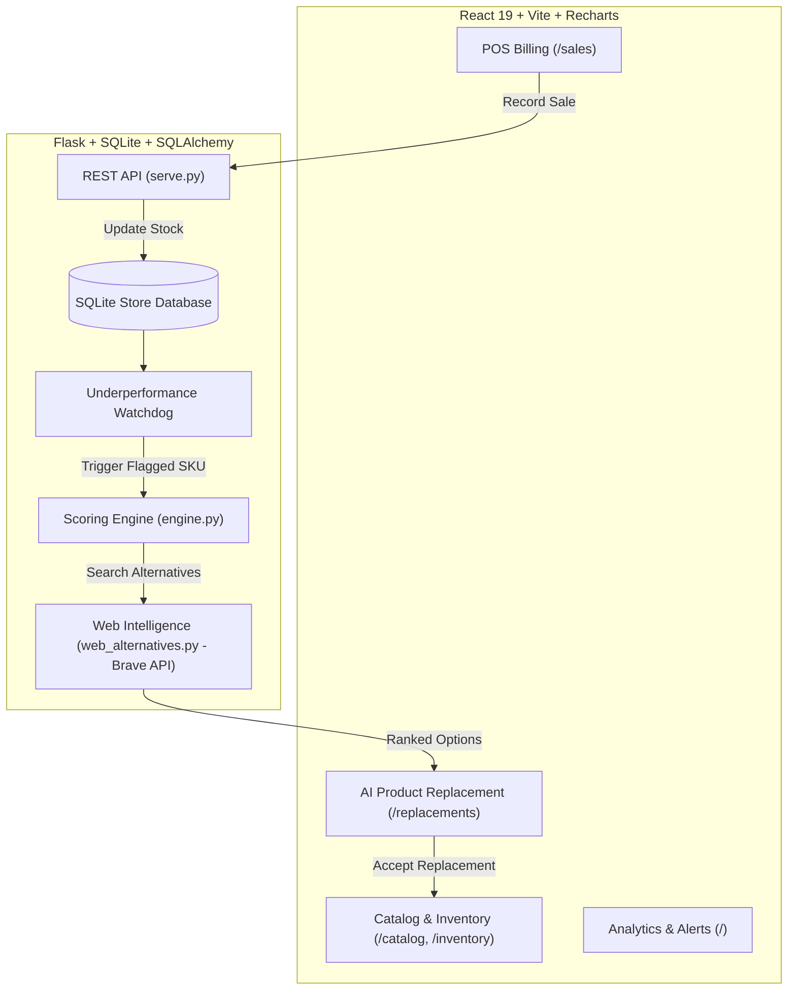

# StorePulse — Retail OS with Autonomous Product Replacement & Capital Recovery

## 1. Problem Grounding: What Real Shop Owners Suffer From

Based on real discussions from retail communities (**r/smallbusiness**, **Kirana Club**, **The Boutique Hub**, and **Retail Owners Institute**), shop owners across categories (grocery, personal care, apparel, specialty retail) face the same 5 universal headaches:

1. **"The Cash Trap" (Dead Stock)**:
   - *Forum Quote*: *"I have $12,000 sitting on shelves that hasn't moved in 4 months. My supplier won't take it back, and I don't have cash to buy fast-selling items."*
   - Retailers operate on tight margins (15–30%). When 50 units of a product sit unsold, that entire category's profit is frozen.

2. **"The Distributor Trap" (Over-ordering & Wrong Stock)**:
   - Sales reps push large minimum order quantities (MOQs) or bulk schemes promising high demand. The retailer takes the bait, and the product dies.

3. **"The Closed-World Software Blindspot"**:
   - Standard POS software (Square, Lightspeed, Vyapar, Marg) only records past receipts. When a product dies, the software says: *"Product is slow. Give a 30% discount."*
   - **The owner's dilemma**: Discounting helps liquidate old stock at a loss, but **what should they replace it with tomorrow morning?**

4. **"Customer Trend Desynchronization"**:
   - Consumer demand shifts fast (e.g., shifts toward sulfate-free, Korean beauty, organic, regional brands). Small owners learn about these shifts 6 months too late after losing foot traffic to bigger stores or online sellers.

5. **"Fear of Clearance"**:
   - Owners hate putting up 50% discount signs because it looks like store failure. Forum consensus favors **creative bundling** (pairing the slow mover with a high-margin hero product at the POS) over raw clearance.

---

## 2. Core Value Proposition: StorePulse vs. Traditional POS

```
Traditional POS / ERP (Square, Lightspeed, Vyapar):
Sales Data In  ──>  Count Stock  ──>  "This shampoo is dead. Discount it."  ──>  [End of help]

StorePulse (Open-World Decision Intelligence):
Sales Data In  ──>  Detect Trapped Capital
                   └──> Web Market Intelligence (Brave Search / Ratings / Trends)
                         └──> 2-Step Actionable Execution:
                               1. POS Bundle Recipe to liquidate old stock cleanly.
                               2. Vetted Replacement SKU (better margin, 4.5★+ reviews, trending).
```

---

## 3. Product Modules

### Module 0: First-Time Setup & Personalization (The "Welcome Experience")
Before any selling happens, StorePulse walks you through a **beautiful, animated 5-step setup** that feels like a helpful assistant — not a form. No technical knowledge needed.

| Step | What You Do | Why It Matters |
|------|-------------|----------------|
| **1. Your Store** | Enter shop name, owner name, address, phone, email, GSTIN, default tax % | Appears on receipts, dashboard, supplier messages |
| **2. Your Suppliers** | Add each supplier: name, contact person, phone, WhatsApp, email, preferred channel (WhatsApp/Email/Call) | One-click restock messages later |
| **3. Low Stock Alerts** | Set default threshold (e.g., "Alert me at 15 units") + per-category overrides | Never run out without knowing |
| **4. Message Templates** | Write once per channel (WhatsApp, Email, Call) with placeholders like `{{product_name}}`, `{{qty}}`, `{{store_name}}` | Click "Order Now" → message ready to send |
| **5. You're Ready!** | Celebration animation, summary card, one click to Dashboard | Feels complete, not configured |

**Skip option** always available — minimal defaults applied, you can refine later in Settings.

---

### Module 1: Daily Store Operations (Fast & Practical POS)
- **Point of Sale (POS)**: Quick cart billing with barcode / search, cash/card/UPI payment capture, automatic stock deduction.
- **Instant Digital & Printable Receipts**: Clean receipt generation with store branding.
- **Product & Category Catalog**: SKU, barcode, category/subcategory, cost price, selling price, current stock.
- **Inventory Ledger**: Real-time stock counts, restock history, low-stock threshold triggers.

### Module 2: Trapped Capital Watchdog (Autonomous Underperformance Detection)
- Continuous evaluation of stock velocity:
  - **Capital at Risk**: $\text{Remaining Stock} \times \text{Cost Price}$
  - **Velocity Ratio**: $\frac{\text{Units Sold in 30 Days}}{\text{Average Stock on Hand}}$
- When $\text{Velocity Ratio} < 20\%$ and $\text{Days on Shelf} > 45$, the product is flagged into the **Underperformance Queue**.

### Module 3: Open-World AI Replacement Engine (The Moat)
- **Market Search (`web_alternatives.py`)**:
  - Automatically queries online market sources for the same category, subcategory, and price range.
  - Extracts title, live pricing, customer rating ($/5$), review volume, and product specs/ingredients.
- **Value-Quality-Margin Scoring**:
  $$\text{Score} = \text{Text Similarity} \times \text{Rating Confidence} \times \text{Price/Margin Competitiveness}$$
- **Replacement Dossier**: Presents top 3 alternative brands explaining *why* they outperform the current SKU.

### Module 4: 2-Step Actionable Execution — From Alert to Order in One Click
For every flagged product, the owner gets a **low stock popup** that bridges directly to the supplier:

1. **Low Stock Popup Appears** — *"Dove Shampoo at 12 units (alert at 15). Supplier: Unilever Distribution. Suggested order: 30 units (₹6,300)."*
2. **Choose Channel & Send** — Buttons: 📱 **WhatsApp** | 📧 **Email** | 📞 **Call**
   - Click → opens your WhatsApp / Gmail / Phone app with **pre-filled message** using your template
   - Message auto-filled: product name, SKU, quantity, your store name, supplier contact person
3. **Track the Order** — Click "Mark as Ordered" → creates Purchase Order in system
4. **Receive Stock** — When delivery arrives → click "Receive" → stock updates instantly

**No typing, no copy-paste, no switching apps.** The message is ready in your preferred app.

---

### Module 5: Real-Time Analytics Dashboard

### Module 5: Real-Time Analytics Dashboard
- Net Revenue & Gross Margin trends (Week, Month, Quarter).
- Capital Health: Free Working Capital vs. Trapped Inventory Capital.
- Category Breakdown: Profit per square foot / category contribution.
- Replacement Audit: How much extra profit was unlocked by replacing dead SKUs.

---

## 4. Technical Architecture



---

## 5. Phased Roadmap

| Phase | Focus | Deliverables |
| :--- | :--- | :--- |
| **Phase 0** | **First-Time Setup & Personalization** | Animated 5-step Setup Wizard (store info, suppliers, alerts, message templates), Supplier management, Message templates with placeholders, Route guard, Skip option. |
| **Phase 1** | **Store Foundation** | SQLite database, Products CRUD, Stock In/Out, Stock Alerts. |
| **Phase 2** | **POS & Billing** | Fast cart checkout, Bill generation, Sales history, Auto inventory deduction. |
| **Phase 3** | **Trapped Capital Watchdog** | Velocity calculation, Dead stock & capital-at-risk identification. |
| **Phase 4** | **AI Replacement Engine** | Automated web search, consumer rating & price arbitrage scoring, recommendation cards. |
| **Phase 5** | **POS Bundling & Execution** | One-click bundle creation to clear old inventory + catalog replacement. |
| **Phase 6** | **Supplier Bridge & Restock Flow** | Low stock popup with channel buttons (WhatsApp/Email/Call), pre-filled messages via templates, Purchase Order tracking, Receive stock workflow. |
